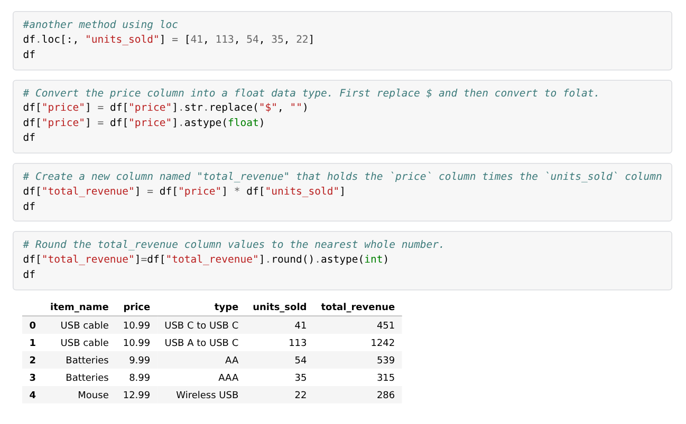
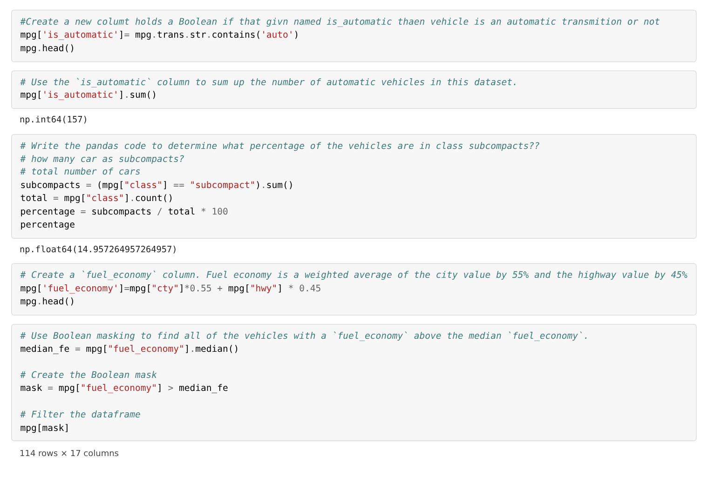
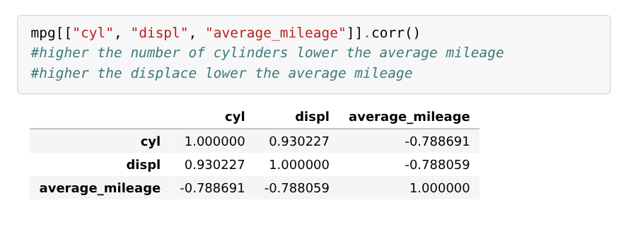
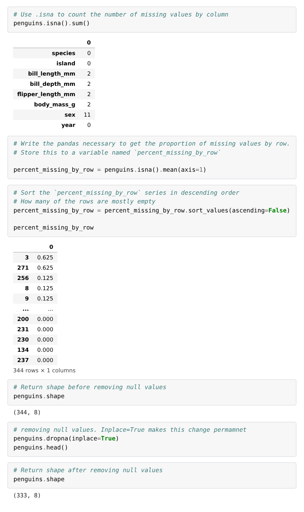
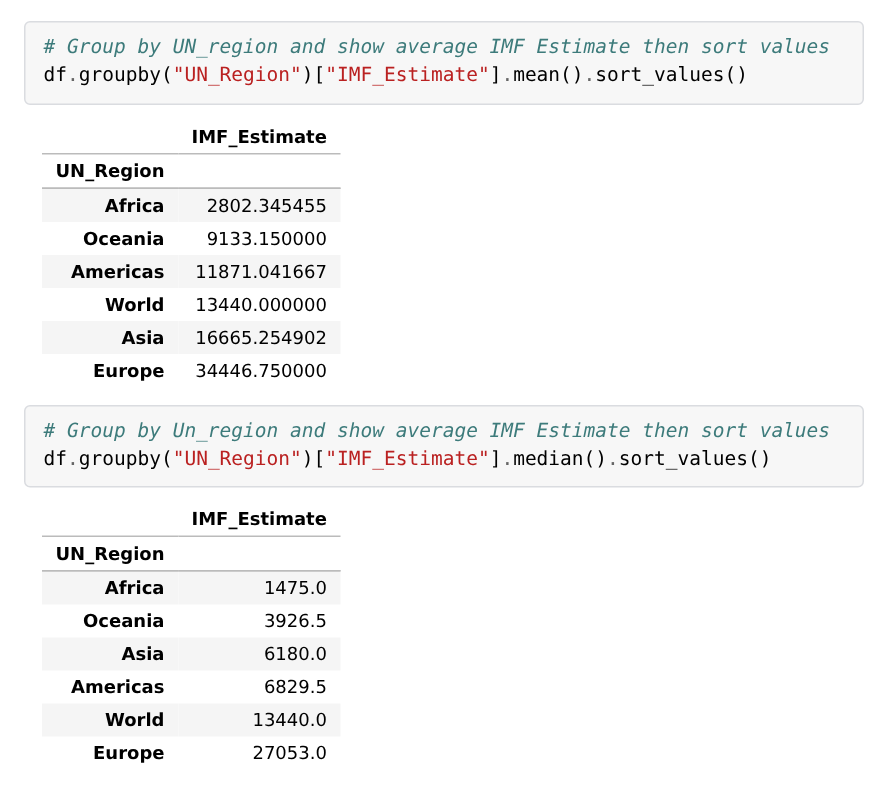
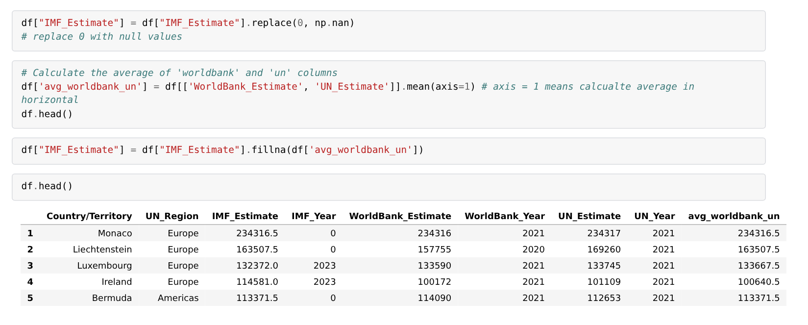
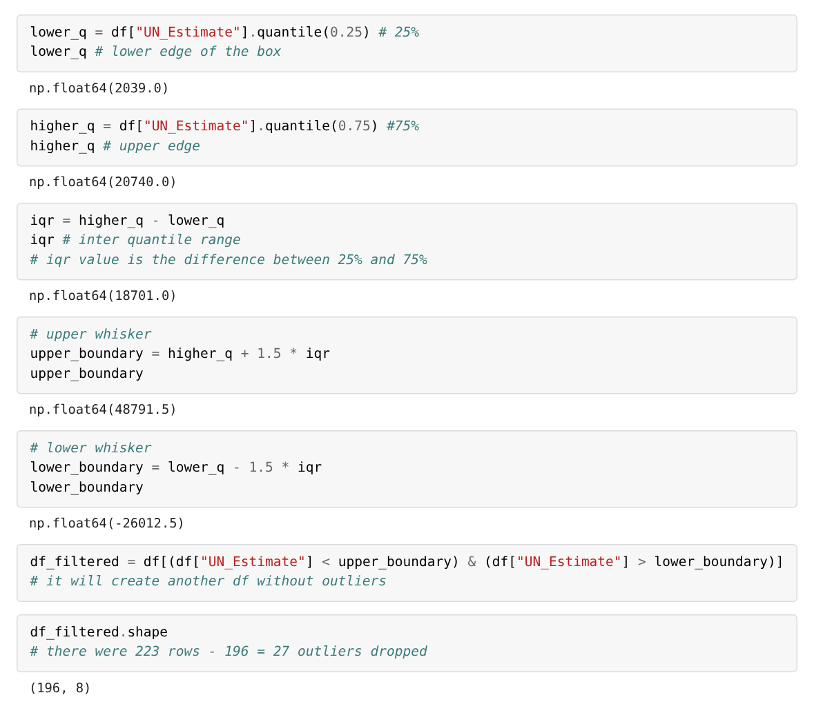
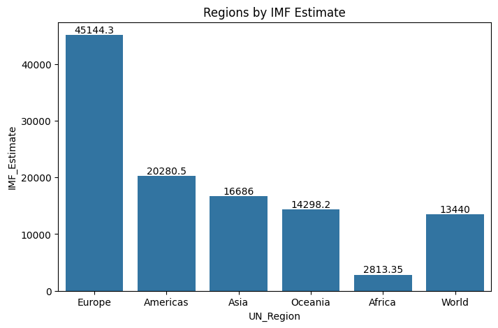
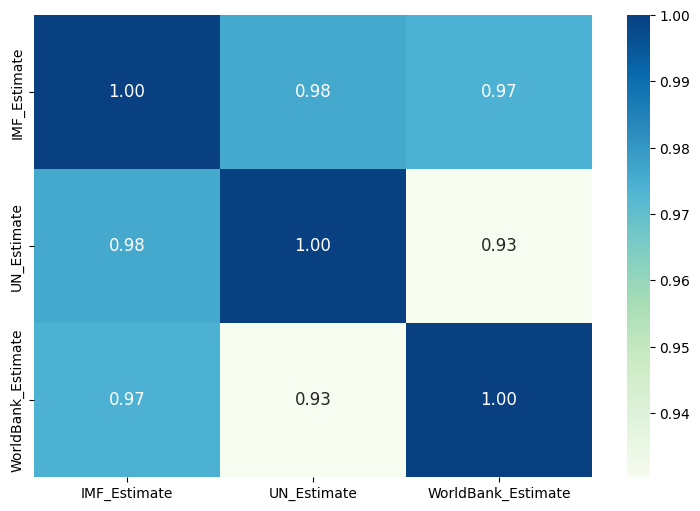
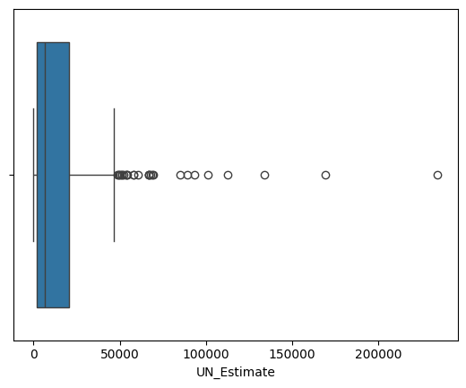

# 🐼 Python pandas: exploring and cleaning data

Four Google Colab notebooks from Week 6 of my bootcamp, where I used pandas to explore, clean and analyse four datasets: a small sales table, car fuel economy, penguin measurements with missing values, and GDP per capita for 223 countries and territories. I filtered and selected data with Boolean masks and `.loc`, cleaned it with `dropna()`, `fillna()` and `astype()`, summarised it with `groupby()` and `sort_values()`, and charted it with Matplotlib and seaborn.

## 🔎 At a glance

| | |
|---|---|
| **Tools** | Python 3, pandas, NumPy, Matplotlib, seaborn, Google Colab |
| **Datasets** | A sales table built in code, mpg (234 cars), Palmer penguins (344 penguins) and GDP (nominal) per capita (223 countries and territories), plus a student marks file (35 students) |
| **Bootcamp week** | Week 6 (October 2026), Level 3 Data Technician Skills Bootcamp, Leep Talent |
| **Type** | Course notebooks. The first three teach pandas through worked examples and end with exercises that I completed. The GDP notebook is a guided analysis that I worked through. |
| **Colab links** | [Task 1](https://colab.research.google.com/drive/1QpG9AGITvzolcj2Q5HGzwNDDucIp6Fns?usp=sharing) · [Task 2](https://colab.research.google.com/drive/1OkaoYrETIEQQwl80lXGj9dHoVeyDl8Bo?usp=sharing) · [Task 3](https://colab.research.google.com/drive/1bvXZ8Vp_cpGCjxlsx5qphVxIzRcSMGZ-?usp=sharing) · [Task 4](https://colab.research.google.com/drive/1fun0EuyUbmDeHxVpL-9G4veBi4_Z5FyL?usp=sharing) |

## 🎯 Objective

Use pandas to load data, filter and select it, deal with missing values and outliers, summarise it by group and chart it, and check along the way that the numbers make sense.

## 🗂️ Data

| File | What it is | Used in |
|---|---|---|
| `data/mpg.csv` | Fuel economy for 234 cars from 1999 and 2008: manufacturer, engine size, cylinders, transmission, city and highway miles per gallon, and vehicle class | Task 2 |
| `data/penguins.csv` | Measurements of 344 penguins of three species from the Palmer Archipelago, Antarctica, with some values missing | Task 3 |
| `data/GDP_nominal_per_Capita.xlsx` | GDP per capita in US dollars for 223 countries and territories, with separate estimates from the IMF, World Bank and UN | Task 4 |
| `data/student.xlsx` | A sample class list of 35 students: name, class, mark and gender | A class exercise in Colab (that notebook isn't included here) |

The mpg data comes from US fuel economy figures and is a standard teaching dataset. The penguins file is the public Palmer Penguins dataset. The GDP data is a [Kaggle dataset](https://www.kaggle.com/datasets/rajkumarpandey02/gdp-in-usd-per-capita-income-by-country), and the notebook read a CSV copy of the same table. To rerun a notebook in Colab, upload its dataset first.

## 🛠️ Approach

| Notebook | What it covers | What I did |
|---|---|---|
| [Task 1: DataFrames](notebooks/day4-task1-pandas-dataframes.ipynb) | Creating DataFrames, adding and renaming columns, summary statistics | Built a sales table, cleaned text prices into numbers, calculated revenue and exported the result to CSV and Excel |
| [Task 2: fuel economy](notebooks/day4-task2-mpg-fuel-economy.ipynb) | Loading a CSV, selecting columns, Boolean filters, sorting | Flagged automatic cars, worked out the share of subcompacts, built a weighted fuel economy score and filtered cars above the median |
| [Task 3: missing values](notebooks/day4-task3-penguins-missing-values.ipynb) | Finding, counting and dropping missing values | Counted missing values by column and by row, then dropped incomplete rows |
| [Task 4: GDP per capita](notebooks/day4-task4-gdp-per-capita.ipynb) | Exploratory analysis, filling missing values, charts and outliers | Compared three sources, summarised by region, filled missing IMF figures, drew histograms, a heatmap, bar charts and box plots, and removed outliers with the interquartile range |

## 🧩 Code highlights

Screenshots of code and output from my notebooks, each showing a different pandas technique.

### Selecting with `.loc` and cleaning a text column

`.loc[:, "units_sold"]` selects every row (`:`) of the `units_sold` column and fills it with the sales figures. Prices arrived as text, such as "$10.99", so I removed the $ sign with `str.replace()` and turned the column into numbers with `astype(float)`. Revenue is then price times units, rounded to whole numbers. The USB A to USB C cable brought in $1,242, the most of the five products.

### Filtering with Boolean masks

`str.contains('auto')` marks each car True or False, and adding up the True values counts them: 157 of the 234 cars are automatic. The same idea gives the share of subcompacts (15.0%). The fuel economy score weights city driving at 55% and highway at 45%, and the mask keeps only the 114 cars above the median score.

### Checking a relationship

`corr()` shows that cylinders and engine size both have a correlation of −0.79 with average mileage: the bigger the engine, the fewer miles per gallon.

### Finding and dropping missing values

`isna().sum()` counts the gaps in each column: 11 penguins have no sex recorded and 2 have no body measurements. `isna().mean(axis=1)` does the same for each row, and `sort_values()` puts the emptiest rows first: two rows are 62.5% empty. `dropna()` removes every row with a gap, taking the data from 344 rows to 333.

### Summarising by group

`groupby("UN_Region")` collapses the countries into regions, and `sort_values()` ranks them. Africa is lowest and Europe highest either way, but Asia and the Americas swap places between the mean and the median, because a few very wealthy countries pull the mean up.

### Filling missing values

In this dataset a missing IMF estimate is stored as 0. `replace(0, np.nan)` marks those as missing, and `fillna()` fills each one with the average of the World Bank and UN estimates for that country. Monaco, for example, now has an IMF figure of $234,316.50.

### Removing outliers with the interquartile range

The middle half of countries have a UN estimate between $2,039 and $20,740. Anything more than 1.5 times that range above the upper quartile, $48,791.50, counts as an outlier. Filtering with `&` keeps the 196 rows inside the boundaries, so 27 outliers were removed.

## 📸 Charts from the GDP notebook

**Average IMF estimate by region**, after missing IMF figures were filled

**How closely the three sources agree:** correlations between 0.93 and 0.98

**Spread of the UN estimate.** The points to the right are the outliers removed above.

## 📈 Results

- **Fuel economy:** the most economical car is the 1999 Volkswagen New Beetle 1.9 diesel manual, at 35 mpg in town and 44 on the highway. The least economical are 4.7-litre four-wheel-drive pickups and SUVs, at 9 and 12.
- **Penguins:** dropping incomplete rows removes 11 of the 344 penguins, about 3% of the data.
- **GDP per capita:** the median IMF estimate is $5,421, but the mean is $15,352. Removing outliers cuts the mean UN estimate from $17,767 to $9,415, which shows how far a few very wealthy places skew the average.
- **Data quality:** `UN_Year` is stored as text because one value carries a footnote marker, `[n 10]2021`.

## 💡 Skills used

**Technical**
- Loading and exporting data: `read_csv()`, `to_csv()` and `to_excel()`
- Exploring: `head()`, `tail()`, `sample()`, `shape`, `info()`, `describe()`, `dtypes`, `unique()` and `value_counts()`
- Filtering and selecting: column lists, `.loc`, Boolean masks with `&`, `str.contains()`, `nlargest()` and `nsmallest()`
- Cleaning: `isna()`, `dropna()`, `fillna()`, `replace()`, `str.replace()`, `astype()`, `rename()` and `drop()`
- Summarising: `groupby()` with `mean()` and `median()`, `sort_values()`, `corr()` and `quantile()`
- Visualising with Matplotlib and seaborn: histograms, a heatmap, bar charts, a scatter plot and box plots

**Transferable**
- Checking data quality before analysis, such as numbers stored as text and zeros that really mean "missing"
- Comparing the mean with the median before trusting an average
- Explaining each step in comments, so someone else can follow the work

## 🧠 What I'd change

- **A zero isn't always a zero.** Missing IMF figures were filled with the average of the World Bank and UN figures, but for 8 territories the UN figure was also 0. Their filled value is half their World Bank figure: the Isle of Man shows $43,579 against a World Bank estimate of $87,158. Replacing zeros with blanks in both columns first would fix this. The same zeros stay in the UN column after outliers are removed, which pulls that average down.
- **Leave out totals.** The GDP table includes a "World" row, which is a total rather than a country. It shows up as its own region in the group summaries, and removing it first would keep the comparison to real countries.

## 💼 Where this applies

A pandas script that filters, cleans and totals a file can be rerun on next month's data and repeats exactly the same steps. That makes the work quicker to repeat and easier for a reviewer to check than manual spreadsheet edits. Spotting that a zero really means "missing", or that a total row has crept into the data, is the kind of check that matters in audit, tax and analyst work alike.

## 📁 Repository contents

| File or folder | What it is |
|---|---|
| `Data_Technician_Workbook_Week_6.docx` | My completed Week 6 workbook, with the Colab link for each notebook |
| `notebooks/` | The four pandas notebooks, downloaded from Colab with their output saved |
| `data/` | The datasets used in the notebooks, plus the student marks file |
| `images/` | Screenshots of code and output from the notebooks, and three charts from the GDP notebook |
